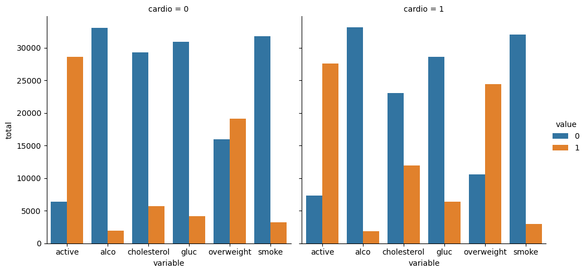
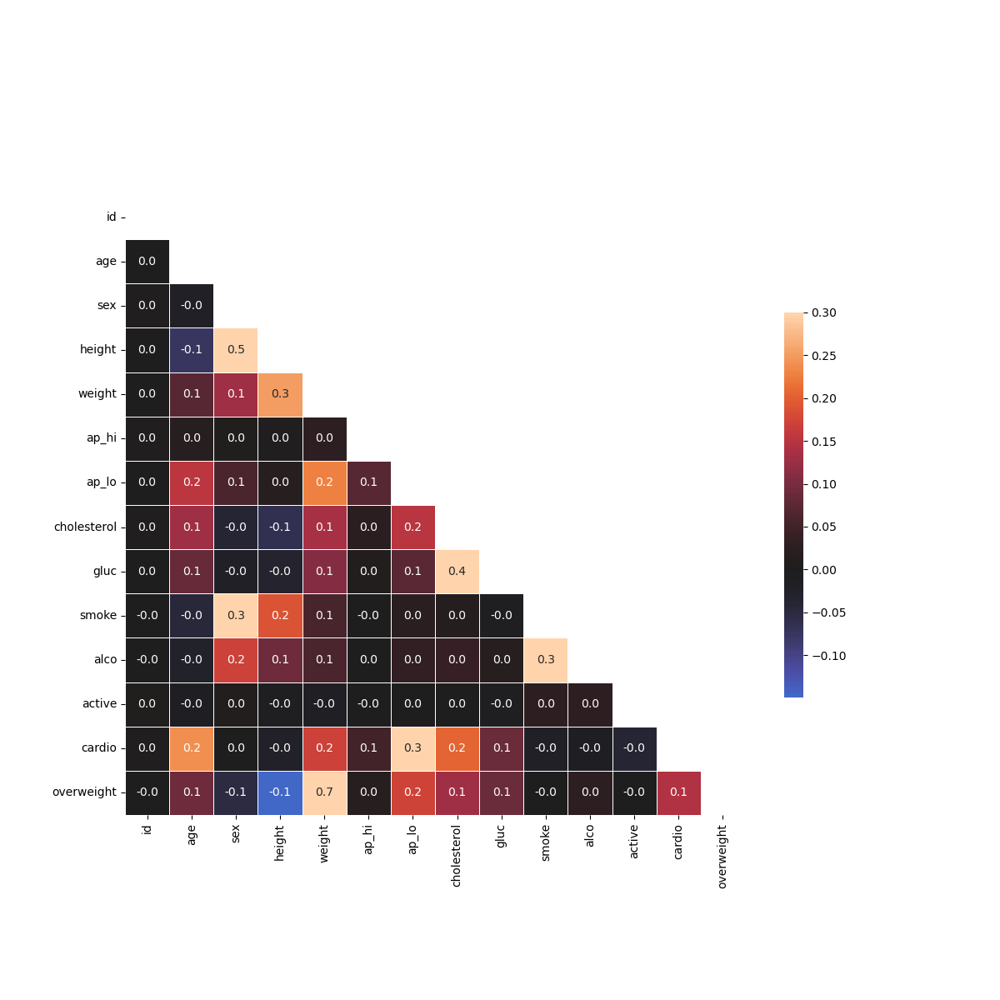
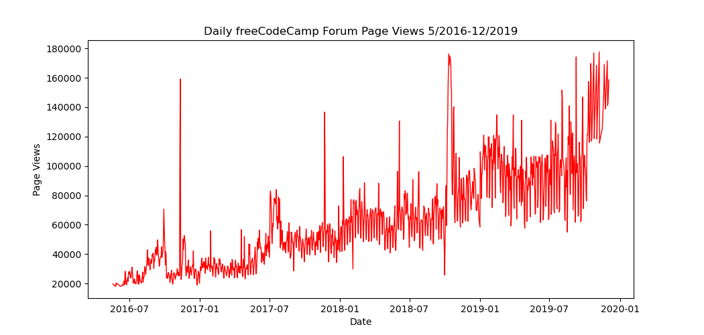
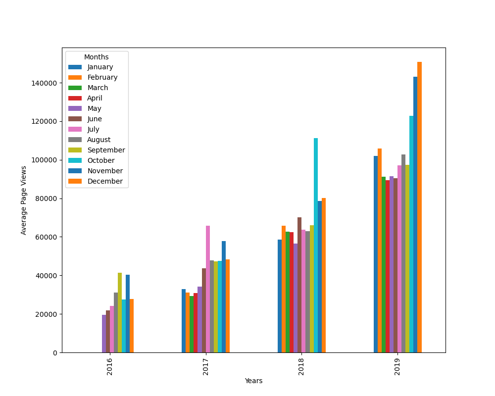
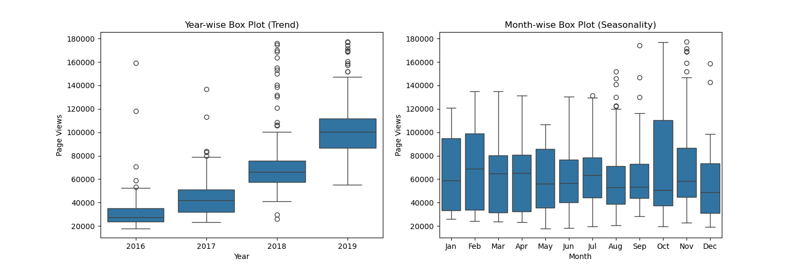
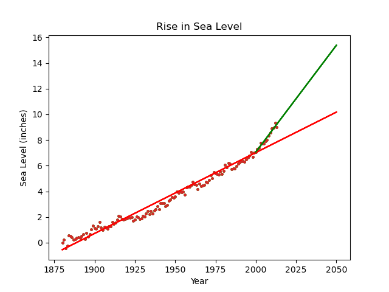

# Data Analysis with Python — freeCodeCamp

Practice projects for the freeCodeCamp Data Analysis with Python certification, by Harsh Ganesh Kalambe, a second-year B.Sc. Data Science student at KES Shroff College, Kandivali, Mumbai.

**Status: in progress — certificate not earned yet.** All five projects in this repository were submitted on freeCodeCamp on 9 November 2026 and are marked Passed there. The certificate itself is not earned yet — the 28 lesson challenges still need to be completed — and nothing here claims a completed certificate.

## About this repository

This repository holds the five certification projects from freeCodeCamp's Data Analysis with Python course. Each project is in its own folder with its code, its dataset, and its test file. The aim of the work was to practise the basics of data analysis in Python: reading data, cleaning it, asking questions of it with Pandas and NumPy, and presenting the answers with Matplotlib and Seaborn.

## Technologies and tools

- Python 3.12
- NumPy — array calculations (Project 1)
- Pandas — reading, filtering, grouping and summarising data (Projects 2–5)
- Matplotlib — line, bar and box plots, scatter plots (Projects 3–5)
- Seaborn — categorical plots and heatmaps (Projects 3–4)
- SciPy — linear regression (Project 5)

See `requirements.txt` for the pinned versions used when testing locally.

## Projects

### Project 1 — Mean-Variance-Standard Deviation Calculator

- **Code:** `project1/mean_var_std.py` — **Tests:** `project1/test_module.py`
- **Objective:** Write a function that takes a list of 9 numbers and returns the mean, variance, standard deviation, maximum, minimum and sum of the rows, columns and elements of a 3×3 matrix.
- **Dataset:** None — the input is a list supplied to the function.
- **Tools:** NumPy.
- **Methodology:** The list is converted to a NumPy array and reshaped to 3×3. Each statistic is calculated along axis 0 (columns), axis 1 (rows) and for the whole matrix. A list that does not contain exactly 9 numbers raises `ValueError: "List must contain nine numbers."`
- **Results:** Checked against freeCodeCamp's example: `calculate([0, 1, 2, 3, 4, 5, 6, 7, 8])` gives a whole-matrix mean of 4.0, sum of 36, maximum of 8 and minimum of 0.
- **What I learned:** Working with NumPy arrays, reshaping, and calculating statistics along different axes.
- **Tests:** freeCodeCamp's official `test_module.py`, 3 tests, all passing locally.

### Project 2 — Demographic Data Analyzer

- **Code:** `project2/demographic_data_analyzer.py` — **Data:** `project2/adult.data.csv` — **Tests:** `project2/test_module.py`
- **Objective:** Answer 9 questions about a demographic dataset using Pandas.
- **Dataset:** 1994 Census data from the UCI Machine Learning Repository, 32,561 rows (32,563 lines including the header), with columns for age, sex, race, education, occupation, hours worked per week, native country and salary.
- **Tools:** Pandas.
- **Methodology:** `calculate_demographic_data()` reads the CSV, then uses filtering, `value_counts()`, grouping and means to answer each question, rounding percentages to one decimal place.
- **Results:**
  - Average age of men: 39.4
  - People with a Bachelors degree: 16.4%
  - Advanced education earning more than 50K: 46.5%; without advanced education: 17.4%
  - Minimum hours worked per week: 1; of those workers, 10% earn more than 50K
  - Highest-earning country: Iran, 41.9%
  - Top occupation for people earning more than 50K in India: Prof-specialty
  - Race counts: White 27,816; Black 3,124; Asian-Pac-Islander 1,039; Amer-Indian-Eskimo 311; Other 271
- **What I learned:** Filtering DataFrames, grouping data, and summarising it with counts, means and percentages.
- **Tests:** freeCodeCamp's official `test_module.py`, 10 tests, all passing locally. All 9 answers match freeCodeCamp's expected values.

### Project 3 — Medical Data Visualizer

- **Code:** `project3/medical_data_visualizer.py` — **Data:** `project3/medical_examination.csv` — **Tests:** `project3/test_module.py`
- **Objective:** Draw a categorical plot and a correlation heatmap from a medical examination dataset.
- **Dataset:** 70,000 rows of medical examination data, including height, weight, cholesterol, glucose, smoking, alcohol use, physical activity, blood pressure and cardiovascular disease.
- **Tools:** Pandas, Matplotlib, Seaborn.
- **Methodology:** An `overweight` column is added from BMI (weight / height², 1 when BMI is greater than 25). `cholesterol` and `gluc` are normalised so 0 always means good and 1 always means bad. `draw_cat_plot()` counts cholesterol, glucose, smoking, alcohol, activity and overweight, split by cardiovascular disease. `draw_heat_map()` first cleans the data (diastolic pressure not greater than systolic pressure, height and weight within the 2.5th–97.5th percentiles), then draws a correlation heatmap with the upper triangle masked.
- **Results:** Both charts are generated as `catplot.png` and `heatmap.png`. Strongest correlations in the cleaned data: overweight–weight 0.7, height–sex 0.5, cholesterol–gluc 0.4.
- **What I learned:** Adding derived columns, normalising values, reshaping data for plotting with `pd.melt`, and reading a correlation heatmap.





- **Tests:** freeCodeCamp's official `test_module.py`, 4 tests, all passing locally.

### Project 4 — Page View Time Series Visualizer

- **Code:** `project4/time_series_visualizer.py` — **Data:** `project4/fcc-forum-pageviews.csv` — **Tests:** `project4/test_module.py`
- **Objective:** Clean a daily page-view time series and visualise it as line, bar and box plots.
- **Dataset:** Daily freeCodeCamp forum page views, 1,304 days from 9 May 2016 to 3 December 2019.
- **Tools:** Pandas, Matplotlib, Seaborn.
- **Methodology:** The data is cleaned by dropping days in the top and bottom 2.5% of page views (1,304 → 1,238 rows). `draw_line_plot()` plots daily page views over time. `draw_bar_plot()` plots average monthly page views grouped by year. `draw_box_plot()` plots year-wise box plots (trend) and month-wise box plots (seasonality).
- **Results:** Median daily page views in the cleaned data: 57,197. Highest monthly average: December 2019, about 150,734 page views per day.
- **What I learned:** Parsing dates, setting a date index, cleaning a time series by percentile, and grouping data by year and month for plotting.







- **Tests:** freeCodeCamp's official `test_module.py`, 11 tests, all passing locally.

### Project 5 — Sea Level Predictor

- **Code:** `project5/sea_level_predictor.py` — **Data:** `project5/epa-sea-level.csv` — **Tests:** `project5/test_module.py`
- **Objective:** Plot sea level against year and predict the sea level in 2050 with two lines of best fit.
- **Dataset:** 134 yearly records, 1880–2013, CSIRO Adjusted Sea Level in inches. The copy in this repository carries the two columns this project uses (Year and CSIRO Adjusted Sea Level) with freeCodeCamp's frozen boilerplate values; the full EPA file also has Lower/Upper Error Bound and NOAA Adjusted Sea Level columns, and the live copy of that file has since revised the 1990–2013 values.
- **Tools:** Pandas, Matplotlib, SciPy.
- **Methodology:** `draw_plot()` draws a scatter plot of sea level against year, then fits two lines with SciPy `linregress` and extends both to 2050: one using all the data (1880–2013), one using only data from 2000 onwards.
- **Results:**
  - All data (1880–2013): about 0.063 inches per year, predicting about 10.18 inches above the 1880 level by 2050.
  - Data from 2000 onwards: about 0.166 inches per year — the rise is faster in recent decades — predicting about 15.38 inches by 2050.
- **What I learned:** Fitting lines of best fit with linear regression and comparing a long-term trend with a recent trend.



- **Tests:** freeCodeCamp's official `test_module.py`, 4 tests, all passing locally. The project was submitted on freeCodeCamp on 9 November 2026 and is marked Passed there.

## Repository structure

```text
.
├── README.md
├── requirements.txt
├── project1/
│   ├── mean_var_std.py
│   └── test_module.py
├── project2/
│   ├── demographic_data_analyzer.py
│   ├── adult.data.csv
│   └── test_module.py
├── project3/
│   ├── medical_data_visualizer.py
│   ├── medical_examination.csv
│   ├── test_module.py
│   ├── main.py
│   ├── catplot.png
│   └── heatmap.png
├── project4/
│   ├── time_series_visualizer.py
│   ├── fcc-forum-pageviews.csv
│   ├── test_module.py
│   ├── main.py
│   ├── line_plot.png
│   ├── bar_plot.png
│   └── box_plot.png
└── project5/
    ├── sea_level_predictor.py
    ├── epa-sea-level.csv
    ├── test_module.py
    ├── main.py
    └── sea_level_plot.png
```

## Installation

Requires Python 3.12.

```bash
git clone https://github.com/harshkalambe6-crypto/freecodecamp-data-analysis-with-python.git
cd freecodecamp-data-analysis-with-python
pip install -r requirements.txt
```

## How to run

Run from the repository root. Each project works from there — the code finds its own dataset and saves its charts in its own project folder.

```bash
python3 project1/mean_var_std.py
python3 project2/demographic_data_analyzer.py
python3 project3/main.py
python3 project4/main.py
python3 project5/main.py
```

## How to run the tests

Each project's tests are freeCodeCamp's official `test_module.py` for that project. Run them from inside the project folder:

```bash
cd project1 && python3 -m unittest test_module -v
cd project2 && python3 -m unittest test_module -v
cd project3 && python3 -m unittest test_module -v
cd project4 && python3 -m unittest test_module -v
cd project5 && python3 -m unittest test_module -v
```

Test results, run locally: Project 1 — 3/3 pass; Project 2 — 10/10 pass; Project 3 — 4/4 pass; Project 4 — 11/11 pass; Project 5 — 4/4 pass. All five projects were also submitted on freeCodeCamp on 9 November 2026 and are marked Passed there.

## Learning outcomes

Through these five projects I practised: NumPy array operations and statistics; reading and filtering data with Pandas; grouping and summarising data; cleaning data by removing invalid and outlying rows; deriving new columns; and visualising data with Matplotlib and Seaborn, including categorical plots, heatmaps, line, bar and box plots, and scatter plots with lines of best fit.

## Author

Harsh Ganesh Kalambe — B.Sc. Data Science student (second year), KES Shroff College, Kandivali, Mumbai, India. Targeting Data Analyst Intern and Business Analyst Intern roles.

- GitHub: https://github.com/harshkalambe6-crypto
- LinkedIn: https://www.linkedin.com/in/harsh-kalambe-238765446/
